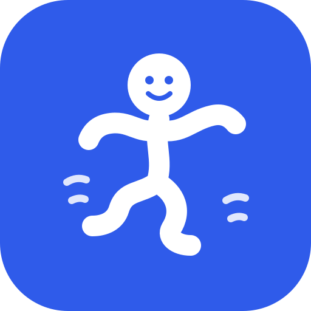
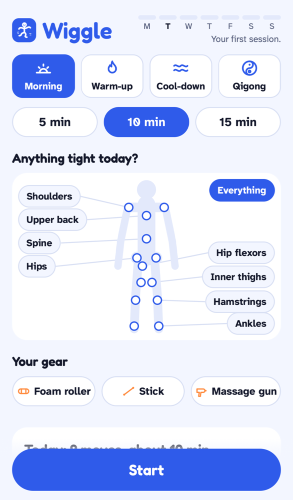
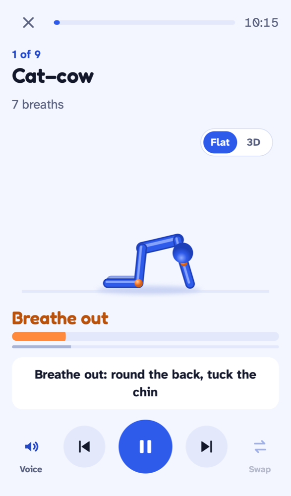

<p align="center">
  
</p>

<h1 align="center">Wiggle</h1>

<p align="center">
  <b>A few minutes of movement, made fresh each day.</b><br>
  Pick what it's for and what feels tight. Wiggle builds the session, then plays it with a moving figure, a breath guide and a voice.
</p>

<p align="center"><a href="https://wiggle.simonwisdom.workers.dev"><b>Open Wiggle</b></a> · Free · Works offline once added to your phone's home screen</p>

<p align="center">
  
  &nbsp;
  
</p>

## What it does

- **Four kinds of session.** Morning goes from the floor up to standing. Warm-up uses moving stretches on a quicker breath. Cool-down uses long holds on a slow breath. Qigong plays the Eight Brocades in their usual order.
- **5, 10 or 15 minutes.** Each day it picks moves you haven't done lately, from 38 no-equipment moves, and orders them so you never jump from standing to the floor and back.
- **Follows your focus.** Tap the areas that feel tight, or the muscle groups you're training, on a body map, or the whole upper or lower body in one tap. Most of the session works those.
- **Your gear, if you have it.** Add a foam roller, a stick or a massage gun and it tops up the session with moves for them.
- **Moves like a person.** Each move is traced from real movement, so the figure reaches, rolls and turns the way you do. Switch to a 3D figure if you like.
- **Eyes optional.** A voice names each move, a soft sound rises on the in-breath and falls on the out-breath, and a chime marks each change. It keeps going with the phone locked or in a pocket, and the headphone buttons pause and skip.
- **Learns from how it felt.** Tell it Easy, About right or Hard. Ask for more or fewer moves and it picks them, swap any move for another for the same muscle, or ask for one more, less or never.
- **Private.** No account. Your history stays in your phone's browser.

## Run it yourself

It's a static web app with no build step and no dependencies.

```sh
npm run dev      # serves public/ at http://127.0.0.1:8731
npm test         # the session builder's tests (Node 20 or later)
```

To host it, serve the `public/` folder from anywhere. `wrangler.jsonc` deploys it to Cloudflare Workers as static files. How the parts fit together is in [DEVELOPING.md](DEVELOPING.md).

## Credits

- Motion traced from movement demo videos with [MediaPipe Pose](https://ai.google.dev/edge/mediapipe/solutions/vision/pose_landmarker). The Eight Brocades follow Peter Chen's front-view demonstration.
- Voice made with [Kokoro-82M](https://huggingface.co/hexgrad/Kokoro-82M) (Apache 2.0).
- Fonts: [Fredoka](https://fonts.google.com/specimen/Fredoka) and [Atkinson Hyperlegible Next](https://fonts.google.com/specimen/Atkinson+Hyperlegible+Next), both under the SIL Open Font License (in `public/fonts/`).
- The 3D renders use [three.js](https://threejs.org) (MIT) and [GSAP](https://gsap.com) ([GSAP's standard licence](https://gsap.com/standard-license)).

## Licence

The code is under the [MIT licence](LICENSE). The motion data (`public/clips.js`), the voice recordings (`public/sound/`) and the 3D clips (`public/clips3d/`) are for running Wiggle and are not covered by it.
